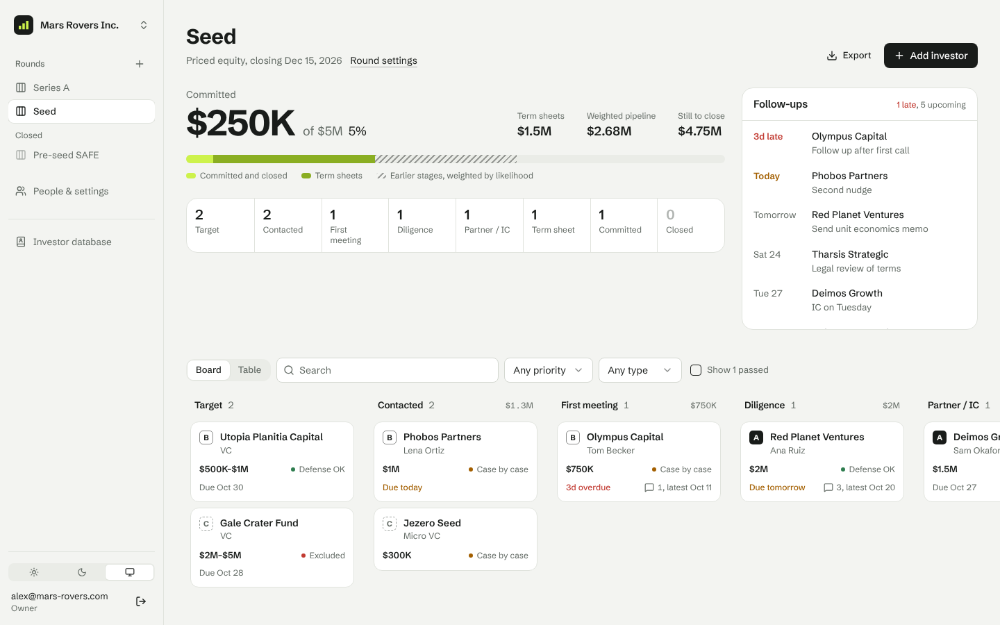
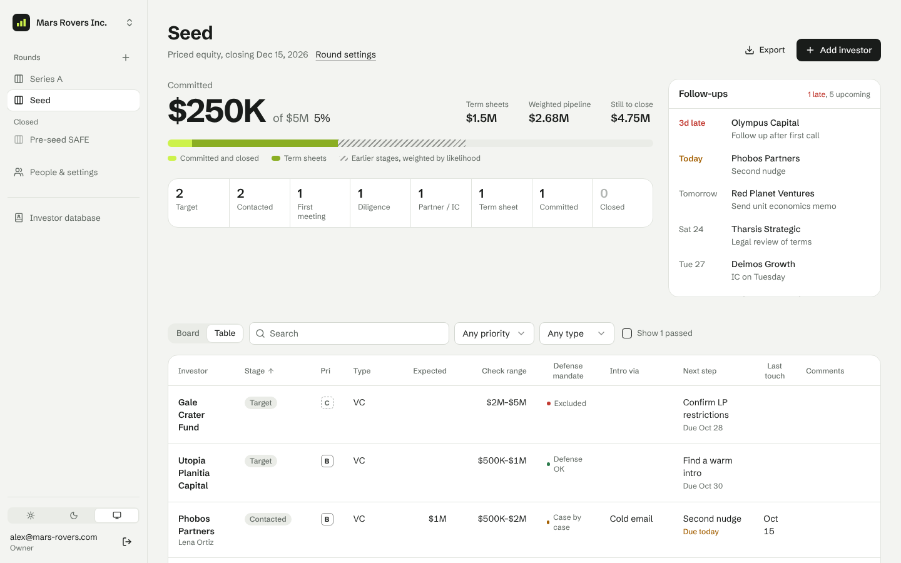
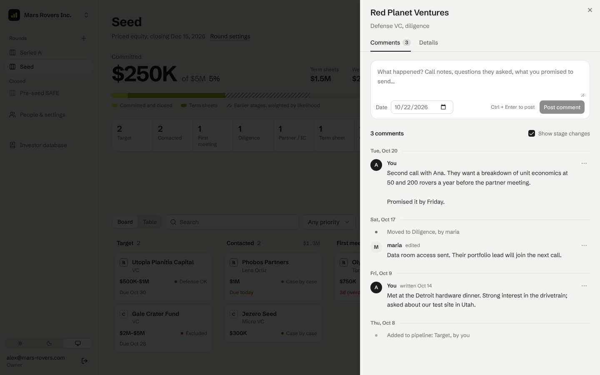
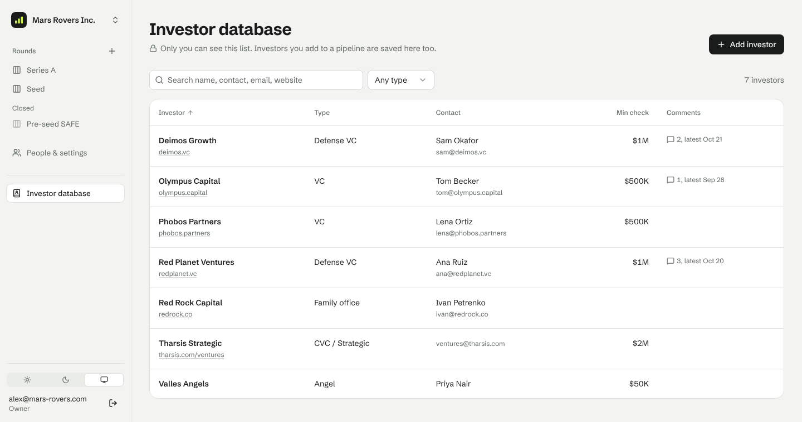
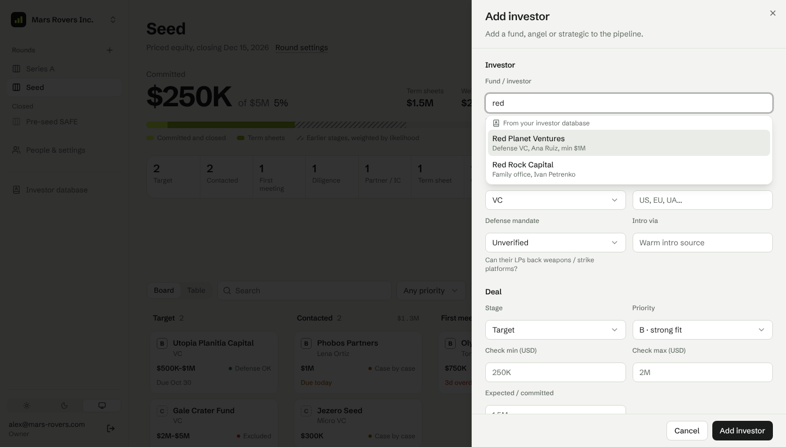
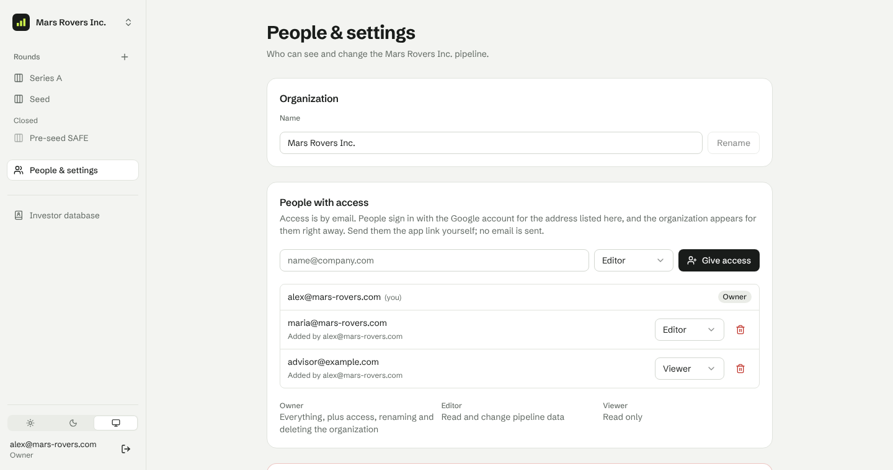
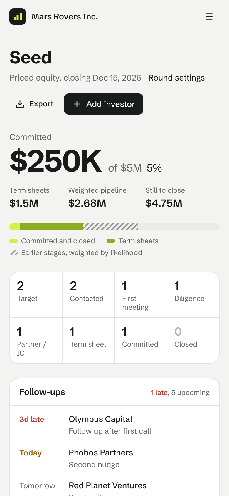
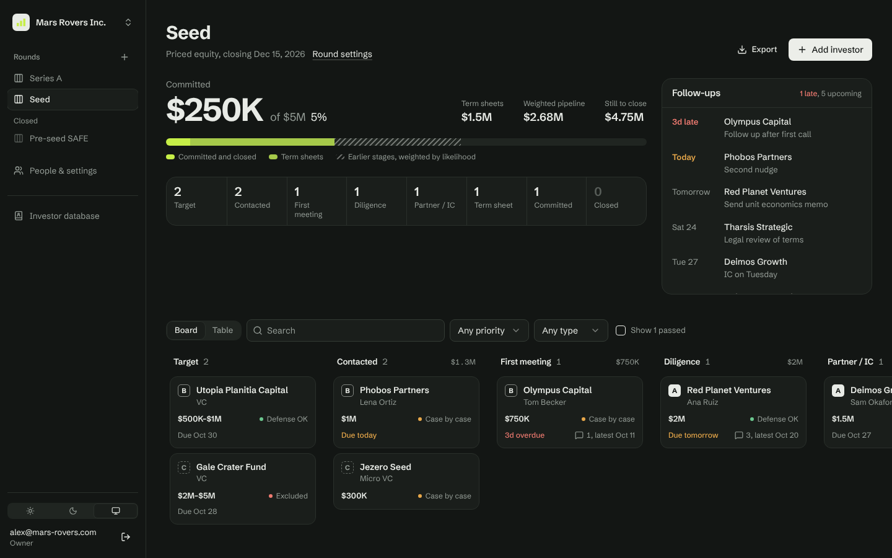

# Venture: fundraising pipeline for founders

Venture is a small CRM for running a startup fundraise. It tracks every investor from the first email to the wire, shows how much of the round is committed, tells you who needs a follow-up today, and lets co-founders work on the same pipeline.

**Live app:** <https://avoronsky.github.io/venture/>. Sign in with Google. It runs on GitHub Pages, with Supabase for sign-in and the database. It's deployed automatically from `main`.



*All screenshots use made-up sample data for a fictional company, Mars Rovers Inc.*

## What it does

### Organizations, rounds and pipelines

- An **organization** is the company you're raising for. Each organization has one or more **rounds** (pre-seed, seed, Series A, a bridge), and each round has its own investor **pipeline**.
- The sidebar lists active rounds first, then closed ones. **+** next to *Rounds* starts a new round. A new round can start with the investors from an earlier round.
- Every investor sits in one of these stages: Target, Contacted, First meeting, Diligence, Partner / IC, Term sheet, Committed, Closed, or Passed.

### Pipeline page

At the top of each round:

- **Raise meter.** It shows how much is committed against the round target, plus term sheets and the *weighted pipeline*. The weighted pipeline counts each investor's expected amount multiplied by the likelihood of its stage.
- **Stage counts.** How many investors are at each stage.
- **Follow-ups.** Next steps by due date, with overdue items first.

Below the meter, two views of the same investors:

- **Board.** Drag cards between stages. Each card shows priority (A, B or C), the check size, whether the fund's mandate allows the deal, the next step's due date, and how many comments it has.
- **Table.** Sortable columns, with the same search and filters as the board.

**Export** downloads the round as a CSV file, for board updates or backups.



### Investor details and dated comments

Click an investor to open its panel. It has two tabs:

- **Comments:** a dated timeline of notes from calls, emails and meetings, with stage changes mixed in so you can see how the deal moved.
- **Details:** contact person, check size, mandate, intro source, next step, and so on.

How comments behave:

- A comment is dated the day it happened. That can be an earlier day than when you write it, and the app then also shows when it was actually written.
- Each comment shows its author. Edited comments are marked as edited.
- Adding a comment updates the investor's "last touch" date.



### Your private investor database

**Investor database** in the sidebar is your own list of investors that you keep across companies and rounds. Each entry has a name, type, website, contact person and email, minimum check, and comments. **Only you can see it.** Teammates and organization owners can't.

- **Saved automatically.** Every investor you add to a pipeline, including those copied into a new round, is saved to your database if it isn't there yet. Investors are matched by name, ignoring upper and lower case.
- **Reusable.** When you add an investor to a pipeline, start typing the name and pick a match from your database. The type, contact person, email and minimum check fill in for you.
- **Separate comments.** Database comments are your private long-term notes. Pipeline comments are shared with the team and belong to one round.
- Removing an investor from your database doesn't remove it from any pipeline.





### Sharing with your team

People sign in with Google. A new user belongs to no organization and is asked to create one; they become its owner. To share, an owner adds a teammate's email address in **People & settings** and gives them a role. The organization appears for that person the next time they sign in with that Google account. No invitation email is sent, so send them the app link yourself.

| Role   | Can see the pipeline | Can change investors, comments and rounds | Can manage people, rename or delete the organization |
|--------|----------------------|-------------------------------------------|------------------------------------------------------|
| Owner  | ✓                    | ✓                                         | ✓                                                    |
| Editor | ✓                    | ✓                                         |                                                      |
| Viewer | ✓                    |                                           |                                                      |

The rules:

- Every organization always keeps at least one owner.
- Anyone can edit their own comments. The author or an owner can delete a comment.
- Only owners can delete a round or the organization.

All of these rules are enforced in the database with row level security, not only hidden in the interface. A user can never read or change another organization's data, or another user's investor database.



### Works on a phone, and in dark mode

<p>
  
</p>



## Where it's deployed

| Piece | Where | How it gets updated |
|-------|-------|---------------------|
| Web app | GitHub Pages: <https://avoronsky.github.io/venture/> | Automatically on every push to `main` (`.github/workflows/deploy.yml`) |
| Sign-in and database | A Supabase project: Postgres, Google sign-in and realtime updates | SQL migrations in `supabase/migrations/`, run by hand in the SQL Editor or by the optional workflow |
| Source | <https://github.com/avoronsky/venture> | |

The web app is a static site. All data lives in Supabase, and the browser talks to Supabase directly. The Supabase key in the app is the public *anon* key: access is controlled by the row level security rules in the migrations, not by keeping that key secret.

## Deploy your own copy

You need a Supabase project, a Google Cloud OAuth client and somewhere to host static files. GitHub Pages is free and already set up in this repo.

### 1. Create the database

1. Create a project at [supabase.com](https://supabase.com).
2. In **SQL Editor**, run each file in `supabase/migrations/` in name order. Copy and paste **the contents of the file**, not its path.
   1. `20261018000000_pipeline.sql`: organizations, members, investors, the activity log, access rules and realtime.
   2. `20261020000000_investor_comments.sql`: dated comments.
   3. `20261022000000_rounds.sql`: multiple rounds per organization. If you're upgrading, the existing round settings become the first round and every investor moves into it.
   4. `20261022100000_investor_database.sql`: each user's private investor database. Investors already in pipelines are copied into their creators' databases.

   Migrations 2 to 4 are safe to run more than once.

   If you have the Supabase CLI, you can instead run `supabase link --project-ref <ref>` and then `supabase db push`, which applies whatever hasn't run yet.

   If you ran the very first single-organization version of this app, first run `supabase/scripts/drop_v1_single_tenant.sql`. It deletes the old tables and their data.

### 2. Set up Google sign-in

1. **Create the OAuth client.** In Google Cloud Console, go to **APIs & Services → Credentials → Create credentials → OAuth client ID** and choose *Web application*.
   - **Authorized redirect URIs:** `https://<project-ref>.supabase.co/auth/v1/callback`. The Supabase Google provider page shows this exact URL.
   - **Authorized JavaScript origins:** optional. Add your app's origin, such as `https://avoronsky.github.io`, and `http://localhost:8087` if you like.
2. **Set up the consent screen.** Configure the OAuth consent screen with an app name and support email, and the scopes `email`, `profile` and `openid`.
3. **Turn on Google in Supabase.** In **Supabase → Authentication → Sign In / Providers → Google**, turn it on, then paste the client ID and secret.
4. **Turn off email sign-in.** In the same section, turn off the **Email** provider. The app only offers Google, and this stops anyone from requesting sign-in links directly against the API.
5. **Set the URLs.** In **Supabase → Authentication → URL Configuration**:
   - Set **Site URL** to the deployed app, for example `https://avoronsky.github.io/venture/`.
   - Add `http://localhost:8087/` to **Redirect URLs** for local development.

Any Google account can sign in, but a new user sees nothing until they create an organization or someone adds their email to one.

### 3. Publish the app on GitHub Pages

1. **Turn on Pages.** In the GitHub repo, go to **Settings → Pages** and set **Source** to **GitHub Actions**.
2. **Add the variables.** Under **Settings → Secrets and variables → Actions → Variables**, add these. They're *variables*, not secrets; both values are public.
   - `VITE_SUPABASE_URL`: from Supabase **Settings → API**.
   - `VITE_SUPABASE_ANON_KEY`: the publishable (anon) key from the same page.
   - `VITE_BASE_PATH`: only if the app is served from a path other than `/venture/`. For example, use `/` for a custom domain or a repo named `<user>.github.io`.
3. **Deploy.** Push to `main`, or run **Actions → Build & Deploy → Run workflow**. The app appears at `https://<user>.github.io/<repo>/`.

The workflow runs type checking, lint, tests and the build on every pull request, and deploys on every push to `main`. Changes to Markdown files, `docs/` or `supabase/` alone don't trigger a deploy. The build writes `404.html` as a copy of `index.html` so links straight to a page, such as `/venture/investors/<id>`, work on Pages.

### Other hosts

Any static host works: Vercel, Netlify, Cloudflare Pages or Firebase Hosting.

- **Build command:** `npm run build`
- **Output folder:** `dist`
- **Environment variables:** the same as above
- **Rewrite rule:** send every path to `index.html`

Add the new URL to Supabase's Site URL and Redirect URLs.

### Run migrations automatically (optional)

`.github/workflows/migrate.yml` runs `supabase db push` whenever files in `supabase/migrations/` change on `main`. It does nothing until you add:

- the variable `SUPABASE_PROJECT_ID`: the project ref
- the secret `SUPABASE_ACCESS_TOKEN`: create one at supabase.com/dashboard/account/tokens
- the secret `SUPABASE_DB_PASSWORD`

## Run it locally

```sh
cp .env.example .env   # fill in VITE_SUPABASE_URL and VITE_SUPABASE_ANON_KEY
npm install
npm run dev            # http://localhost:8087
```

The local app uses the same Supabase project as the deployed one unless you point it at another.

Run the same checks CI runs:

```sh
npm run typecheck
npm run lint
npm test               # Node's built-in test runner over src/lib/*.test.ts
npm run build
```

## How it's built

- **React 19 + TypeScript**, built with **Vite** using `@vitejs/plugin-react-swc`.
- **Tailwind CSS v4.** The theme tokens for light and dark live in `src/index.css`.
- **shadcn/ui** on Radix, with `lucide-react` icons and `sonner` toasts.
- **TanStack Query** for server data. Stage moves update the screen right away and roll back if the save fails.
- **react-hook-form + zod** for forms, **react-router-dom** for routing, and `next-themes` for light and dark mode.
- **Supabase:**
  - Postgres with row level security.
  - Triggers keep the activity log and the investor database up to date.
  - Functions create organizations and rounds.
  - Realtime updates refresh every teammate's screen when someone changes the pipeline.

```
src/
  App.tsx                        providers and routes
  index.css                      Tailwind v4 theme (light and dark)
  components/AppShell.tsx        sidebar: organization switcher, rounds, investor database
  components/pipeline/           Board, InvestorTable, InvestorSheet, RaiseMeter, FollowUps,
                                 RoundSheet, NewRoundForm, DatabaseNameInput (picker from your database)
  components/database/           MyInvestorSheet
  components/comments/           CommentTimeline, shared by pipelines and the database
  components/ui/                 shadcn/ui primitives
  hooks/                         useAuth, useOrganizations, useOrg, useRounds, useCurrentRound,
                                 usePipeline (queries, mutations, realtime), useMyInvestors
  lib/                           pure helpers with unit tests: stages and money, comments, rounds, websites, CSV
  pages/                         Auth, Home, Organizations, Pipeline, InvestorDatabase, OrgSettings
supabase/migrations/             schema, triggers, access rules, realtime
supabase/scripts/                one-off maintenance SQL
docs/screenshots/                images used in this README
.github/workflows/               CI, GitHub Pages deploy, optional migrations
```

| Page address | Shows |
|--------------|-------|
| `/auth` | Sign in with Google |
| `/` | Your last-used organization, or setup for a new user |
| `/orgs` | Your organizations, and a form to create a new one |
| `/o/:orgId` | The last-used round of that organization |
| `/o/:orgId/r/:roundId` | The pipeline for one round |
| `/o/:orgId/r/:roundId/investors/:id` | The pipeline with an investor open. This is a link you can share. `new` opens the add form |
| `/o/:orgId/settings` | Organization name, people with access, leave or delete |
| `/investors`, `/investors/:id` | Your private investor database |

The stage weights for the weighted pipeline are in `STAGES` in `src/lib/pipeline.ts`:

| Target | Contacted | First meeting | Diligence | Partner / IC | Term sheet | Committed | Closed |
|--------|-----------|---------------|-----------|--------------|------------|-----------|--------|
| 2%     | 5%        | 10%           | 25%       | 45%          | 75%        | 95%       | 100%   |

Stage changes and newly added investors are written to the activity log by database triggers, so the history stays consistent no matter which client made the change.
